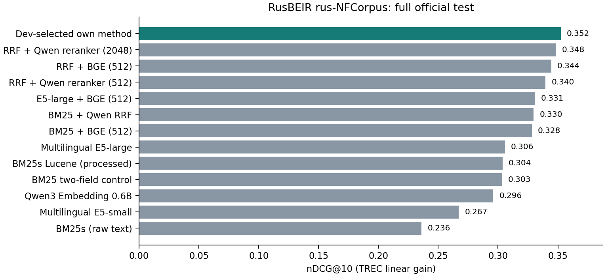
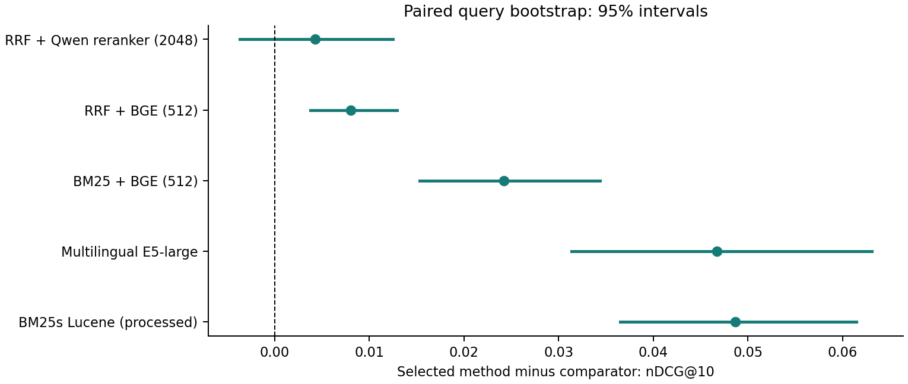
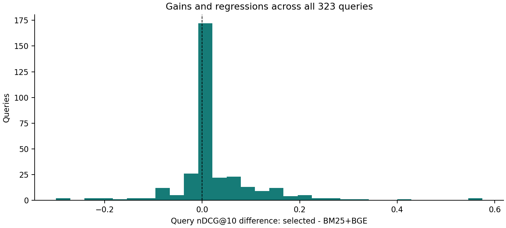

Поиск русскоязычных биомедицинских текстов: опубликованные RusBEIR baselines, гибридный поиск и согласование rerankers

Никита Баграмов и Альфия Исхакова

Natural Language Processing & LLMs, autumn 2026 | 14.11.2026

Abstract

Оценивается ранжирование русскоязычных биомедицинских документов по короткому текстовому запросу. Используется полный официальный rus-NFCorpus из RusBEIR: 3633 документа и 323 test query с градуированными qrels. Сравниваются BM25, multilingual E5-small/E5-large, Qwen3 embeddings и BGE reranking. Собственный вариант объединяет лексический и семантический поиск через RRF, затем согласует BGE и Qwen3 rerankers; веса выбираются только по официальному dev. Основной показатель - точный TREC nDCG@10 с линейным gain. Выбранный метод получает 0.3525 против 0.3282 у воспроизведённого BM25+BGE; парный 95% интервал разности составляет [0.0153, 0.0344]. Описаны отклонения CPU BM25 от Elasticsearch статьи, влияние длины контекста, частичная разметка и регрессии отдельных запросов. Глобальное SotA не заявляется.

Репозиторий: https://github.com/NikiBagramov/russian-biomedical-retrieval

1. Introduction

Лексический поиск требует совпадения слов, тогда как пользователь может сформулировать запрос иным выражением или синонимом. В научных документах важны редкие термины, но релевантность часто определяется отношением между понятиями и контекстом. Это естественная задача NLP: модель читает текст запроса и документа; идентификаторы, qrels и служебные поля не служат признаками.

RQ1: насколько готовые семантические модели выигрывают или проигрывают сильному лексическому baseline в выбранном русском домене; RQ2: даёт ли объединение кандидатов дополнительную релевантность; RQ3: оправдано ли согласование двух rerankers и увеличение token budget. Собственный вклад - проверяемая композиция опубликованных компонентов с dev-адаптацией, а не новая foundation model или генератор научных ответов.

2. Related Work

BEIR [1] предложил разнородную оценку zero-shot информационного поиска. RusBEIR [2] переносит эту идею на русский язык и публикует сравнения на rus-NFCorpus. В его таблице nDCG@10 для этого корпуса BM25 равен .3233, multilingual E5-large .3096, BM25+BGE .3483. Эти значения относятся к исходной конфигурации авторов, а не к нашим измерениям.

Multilingual E5 [3] использует контрастивное обучение представлений. Для inference существенны query:/passage: prefixes, masked mean pooling и нормализация; замена этих деталей меняет метод. BGE [4] предлагает отдельный cross-encoder reranker, который совместно читает пару. Qwen3 Embedding [5] содержит как encoder представлений, так и yes/no reranker с явной инструкцией. Мы сохраняем официальные способы pooling и оформления запросов.

Reciprocal Rank Fusion [6] объединяет ранжирования, не требуя сопоставимой шкалы score. Это удобно для BM25 и dense cosine. В отличие от фиксированного zero-shot baseline, окончательные веса нашего метода подбираются на dev. Поэтому улучшение такой композиции не следует выдавать за строго zero-shot результат той же постановки. Статья о RusBEIR служит опубликованным previous art на конкретном dataset, а не только общей ссылкой на похожую задачу.

| Система | Сохранённая часть | Адаптация |
| --- | --- | --- |
| BM25 | Авторские processed_* поля, Lucene формула | Текущий CPU BM25s объединяет title/text; это отличается от Elasticsearch best_fields статьи |
| E5-small / large | Официальные веса, prefixes, masked mean, L2, 512 tokens | Локальный Transformers inference, FP32 |
| BGE reranker | Top-20, pair classification | 512-token cap следует pinned коду; статья упоминает 2048. BF16 вместо FP32 |
| Qwen embedding | Официальные веса, last-token pooling, L2 | Доменная query-инструкция, 512 tokens |
| Qwen reranker | Официальный system/user/assistant template, yes/no probability | 512/2048 token budgets, protected prefix/suffix, BF16 |

3. Model Description

Sparse baseline индексирует title и text после поставляемой авторами нормализации: processed_title/processed_text уже содержат лемматизацию и удаление stopwords. Используется BM25s Lucene, k1=1.2, b=.75. Контроль raw-text убирает эту предобработку. Двухполевой математический контроль вычисляет max(field scores)+.5*min(field scores); он приближает best_fields tie breaker, но не объявляется битовым воспроизведением Elasticsearch.

Dense методы кодируют title + newline + text. E5 получает query: и passage: prefixes, среднее скрытых состояний по attention mask, затем L2 нормализацию. Для Qwen применяются last-token pooling при left padding, нормализация и английская инструкция поиска биомедицинских фрагментов. Максимальная длина - 512 tokens, счётчики усечений записаны. Косинус считается точным умножением матриц по всем 3633 документам; approximate nearest-neighbor index не используется.

Первый собственный этап объединяет top-100 BM25 и top-100 Qwen embedding. RRF score(d)=sum 1/(60+rank(d)); в отсутствие документа в одном списке его вклад равен нулю. После fusion сохраняется top-100. Reranking переставляет top-20 кандидатов, а хвост 21-100 сохраняет исходный порядок. Поэтому Recall@100 ограничивается retrieval stage и не улучшается от одной перестановки top-20.

BGE совместно читает пару query/document; вход каждого текста ограничен 8192 символами, пара - 512 tokens, как в зафиксированном авторском wrapper. Qwen reranker получает официальный шаблон с <Instruct>, <Query>, <Document> и фиксированным ответным suffix. Вероятность yes вычисляется относительно yes/no logits, только для последнего токена. Этот ограниченный score не интерпретируется как калиброванная вероятность релевантности.

Последний этап складывает reciprocal ranks BGE, Qwen и исходного retrieval. На dev перебираются Qwen weights 0/.25/.5/.75/1, complementary BGE weight, retrieval weights 0/.1/.25 и контексты 512/2048: всего 30 конфигураций. Все одиночные системы остаются в сравнении. Нулевой вес компонента означает, что dev не обнаружил пользы его добавления.

Зафиксированный выбор: Qwen context 2048, Qwen weight 0.25, BGE weight 0.75, retrieval weight 0.25. Настройки test после этого не изменяются. Обучение foundation weights на benchmark не проводится; это вариант dev-adapted fusion готовых языковых моделей.

4. Dataset

Используются официальные kaengreg/rus-nfcorpus и rus-nfcorpus-qrels с зафиксированными revision и SHA. Корпус включает 3633 документа; query ids и document ids проверяются на уникальность, пустых документов не обнаружено. Все официальные train/dev/test query ids сохраняются и не пересекаются. Размеры:

| Официальный split | Queries | Qrels | Число grade 2 |
| --- | --- | --- | --- |
| train | 2590 | 110575 | 0 |
| dev | 324 | 11385 | 521 |
| test | 323 | 12334 | 576 |

Train qrels доступны, но в этом исследовании не используются для градиентного обучения. Dev используется для выбора fusion. Несмотря на упрощённое описание в исходной таблице статьи, реальные dev/test qrels содержат grades 1 и 2; они сохраняются. Восьми dev и шести test query text соответствуют нормализованные тексты из train, что отмечено в аудите. Поскольку train labels не используются, это не является прямой утечкой supervised модели, но ограничивает разнообразие корпуса.

Qrels отражают доступную разметку, а не все возможные истинно релевантные документы. Непомеченный документ получает ноль по правилам benchmark; это не доказательство его смысловой нерелевантности. Перевод исходного NFCorpus и научная специфика также ограничивают перенос результата на произвольный русский поиск.

5. Experiments

Главная метрика - pytrec_eval nDCG@10, та же библиотека TREC, которую вызывает исходный evaluator RusBEIR. Gain линейный по grade; exponential DCG из других пакетов не подставляется. Дополнительно считаются MAP@10, Recall@10/100, P@10 и MRR@10. При равных score порядок фиксирован doc id; для экспорта сохраняются rank scores, чтобы библиотечный tie breaker его не менял.

Контрольный пример с grades 2/1/1 и исходная функция EvaluateRetrieval.evaluate дают тот же результат, что наш thin wrapper. Код upstream без явной top-level лицензии не перепубликуется: сохраняются source hashes, а проверка функции выполнена по локальному pinned source. Основной runtime использует свободный pytrec-eval-terrier 0.5.11 и собственную адаптацию API.

Генераторы embeddings и ранжирований не читают qrels. Dev evaluator читает только development_qrels.json. Выбор и SHA всех runs фиксируются в evaluation_lock, затем открывается отдельный test qrels файл. Парный bootstrap по queries использует 2000 повторов с seed 10. Формирование длинных logits оптимизировано до последнего токена без изменения yes/no формулы. Реальные версии и время сохранены; inference выполняется на RTX 3060 Laptop 6GB.

6. Results

| Метод | Dev nDCG10 | Test nDCG10 | MAP10 | R@100 |
| --- | --- | --- | --- | --- |
| BM25s Lucene (processed) | 0.2736 | 0.3038 | 0.1177 | 0.2430 |
| BM25 + BGE (512) | 0.2929 | 0.3282 | 0.1264 | 0.2430 |
| BM25s (raw text) | 0.2008 | 0.2361 | 0.0844 | 0.1752 |
| BM25 two-field control | 0.2738 | 0.3034 | 0.1178 | 0.2446 |
| Multilingual E5-large | 0.2808 | 0.3057 | 0.1109 | 0.2809 |
| E5-large + BGE (512) | 0.3156 | 0.3310 | 0.1266 | 0.2809 |
| Multilingual E5-small | 0.2512 | 0.2672 | 0.0928 | 0.2472 |
| Qwen3 Embedding 0.6B | 0.2804 | 0.2960 | 0.1045 | 0.2713 |
| BM25 + Qwen RRF | 0.2974 | 0.3297 | 0.1240 | 0.2846 |
| RRF + BGE (512) | 0.3151 | 0.3444 | 0.1324 | 0.2846 |
| RRF + Qwen reranker (2048) | 0.3158 | 0.3482 | 0.1332 | 0.2846 |
| RRF + Qwen reranker (512) | 0.3119 | 0.3396 | 0.1263 | 0.2846 |
| Dev-selected own method | 0.3213 | 0.3525 | 0.1366 | 0.2846 |

Выбранная по dev система получает test nDCG@10 0.3525 с 95% CI [0.3175, 0.3856]. Разность относительно нашего BM25+BGE равна 0.0242. Интервал разности выше нуля.

| Selected минус | Разность nDCG10 | Парный 95% CI |
| --- | --- | --- |
| BM25s Lucene (processed) | 0.0487 | [0.0365, 0.0615] |
| Multilingual E5-large | 0.0468 | [0.0314, 0.0631] |
| BM25 + BGE (512) | 0.0242 | [0.0153, 0.0344] |
| RRF + BGE (512) | 0.0080 | [0.0038, 0.0129] |
| RRF + Qwen reranker (2048) | 0.0043 | [-0.0037, 0.0125] |

Сравнение raw/processed BM25 проверяет пользу языковой нормализации; single-field/two-field контроль - чувствительность движка к полям. E5 small/large проверяет размер encoder, RRF против отдельных retrievers - состав кандидатов, Qwen reranker 512/2048 - контекст. Это несколько заранее определённых сравнений; отсутствие улучшения не скрывается.

| Нейронный этап | Секунды текущего запуска |
| --- | --- |
| e5_small | 78.0 |
| e5_large | 593.8 |
| qwen_embedding | 469.4 |
| bge_reranker512 | 1238.1 |
| qwen_reranker512 | 1661.6 |
| qwen_reranker2048 | 2710.3 |

Runtime - измеренное wall-clock время с описанным кэшем. При возобновлении reranker manifest отдельно показывает число новых и уже кэшированных пар. Это не утверждение о latency сервиса и не сравнение с аппаратурой из статьи. Полные rankings, relevance grades и ideal gains позволяют пересчитать nDCG/MAP/recall из публичных файлов без весов.

6.1. Error analysis and limitations

Для качественного разбора автоматически берутся запросы с наибольшим выигрышем, наибольшей регрессией и медианной разностью nDCG относительно BM25+BGE. Такой выбор явно показывает крайние случаи, а не оценивает их долю. Ниже перечислены первые три результата и их исходные qrels grades.

largest_gain: БМАА Разность nDCG=0.5748.

selected: 2-амино-3-(метиламино)-пропановая кислота (BMAA) в муке из саговника: маловероятная причина бокового амиотрофического склероза и паркинсонизма-слабоумия Гуама. [grade=1]; Цианобактериальный нейротоксин BMAA при БАС и болезни Альцгеймера. [grade=1]; С обложки: Перенос цианобактериального нейротоксина в водной экосистеме умеренного климата указывает на пути воздействия на человека. [grade=1]

BM25+BGE: 2-амино-3-(метиламино)-пропановая кислота (BMAA) в муке из саговника: маловероятная причина бокового амиотрофического склероза и паркинсонизма-слабоумия Гуама. [grade=1]; Диетическое воздействие BMAA в группе пациентов с боковым амиотрофическим склерозом на юге Франции [grade=1]; Нейроповеденческая функция и незначительное воздействие бромированных антипиренов на подростков: перекрестное исследование [grade=0]

largest_regression: Брокколи способствует длительному улучшению функции Печени Разность nDCG=-0.2996.

selected: Отчет: чернослив и функция печени: клиническое исследование. [grade=0]; Потенциальная эффективность ростков брокколи в качестве уникальной добавки для лечения сахарного диабета 2 типа и его осложнений. [grade=0]; Влияние условий приготовления в микроволновой печи на биологически активные вещества, содержащиеся в соцветиях брокколи. [grade=0]

BM25+BGE: Влияние потребления крестоцветных овощей на метаболизм гетероциклических ароматических аминов в организме человека. [grade=2]; Полезные свойства куркумы и куркуминоидов растительного происхождения. [grade=0]; Отчет: чернослив и функция печени: клиническое исследование. [grade=0]

median_difference: Рекомендации по питанию: От молочных продуктов до ягод Разность nDCG=0.0000.

selected: Диетические рекомендации в стоматологической практике. [grade=0]; Влияние диеты с высоким содержанием овощей, фруктов и клетчатки и низким содержанием жиров на прогноз после лечения рака молочной железы [grade=0]; Значительные изменения в рационе питания и употреблении пищевых добавок произошли после постановки диагноза рака молочной железы в многоцентровом исследовании, проведенном в Велико [grade=0]

BM25+BGE: Ценность текущей информации о питании. [grade=0]; Диетические рекомендации в стоматологической практике. [grade=0]; "На пути к еще более здоровой средиземноморской диете". [grade=0]

Ограничения: единственный домен, 323 query, неполные qrels, переводные тексты и возможная неизвестная экспозиция pretrained моделей. Dev grid сам по себе даёт преимущество перед строго zero-shot comparators. CPU BM25 отличается от исходного Elasticsearch, BGE token cap берётся из кода, а не из отличающегося описания статьи. Top-20 reranking не может вернуть документ, отсутствующий среди кандидатов. Поэтому превосходство в данной таблице не эквивалентно доказанному мировому SotA.

7. Conclusion

Создан воспроизводимый текстовый retrieval benchmark с реальными опубликованными конкурентами на том же официальном dataset. Итоговая dev-adapted композиция даёт nDCG@10 0.3525; её вклад оценивается по парным интервалам и всем абляциям. Главный результат - измеренное поведение lexical/dense/reranking компонентов при явных ограничениях, а не перенос чужой цифры из статьи в собственную таблицу.

References

[1] Thakur et al. 2021. BEIR: A Heterogeneous Benchmark for Zero-shot Evaluation of Information Retrieval Models. NeurIPS Datasets and Benchmarks. https://arxiv.org/abs/2104.08663

[2] Kovalev et al. 2025. Building Russian Benchmark for Evaluation of Information Retrieval Models. https://arxiv.org/abs/2504.12879

[3] Wang et al. 2024. Multilingual E5 Text Embeddings: A Technical Report. https://arxiv.org/abs/2402.05672

[4] BAAI. bge-reranker-v2-m3 official checkpoint and usage. https://huggingface.co/BAAI/bge-reranker-v2-m3

[5] Zhang et al. 2025. Qwen3 Embedding: Advancing Text Embedding and Reranking Through Foundation Models. https://arxiv.org/abs/2506.05176

[6] Cormack, Clarke and Büttcher. 2009. Reciprocal rank fusion outperforms condorcet and individual rank learning methods. SIGIR. https://doi.org/10.1145/1571941.1572114

[7] kaengreg. RusBEIR source and data release. https://github.com/kaengreg/rusBEIR

Воспроизводимость. Протокол: PROTOCOL.md; provenance, dev-lock, предсказания: artifacts/. verify_results.py пересчитывает метрики; run_pipeline.py --reproduce --download создаёт новый эксперимент. Генераторы отчёта находятся в scripts/.
