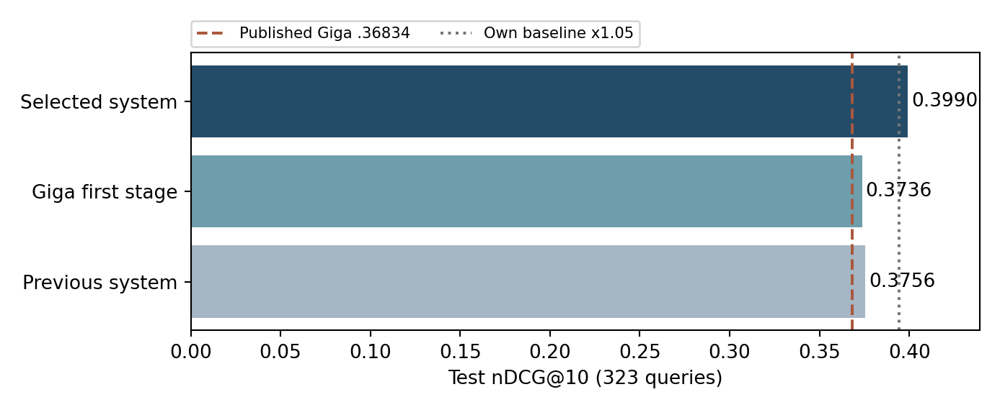
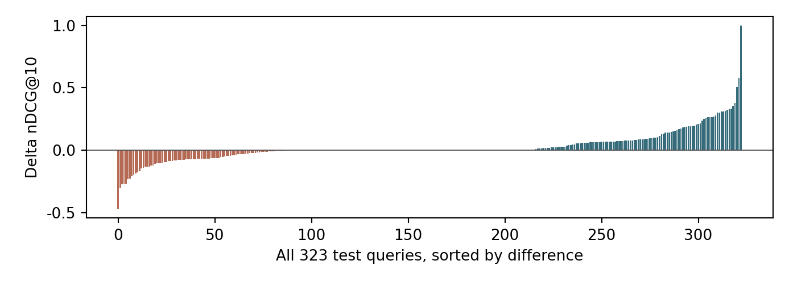

Русскоязычный биомедицинский поиск: доменная инструкция Giga, калибровка реранкера и проверка прироста

Никита Баграмов и Альфия Исхакова

Natural Language Processing & LLMs, autumn 2026 | 16.11.2026

Abstract

На полном официальном rus-NFCorpus исследуется перенос готовых языковых моделей на поиск научных текстов: 3633 документа, 324 dev и 323 test-запроса. После предыдущей композиции BM25/E5/Qwen проведено сравнение глубины переоценки, Giga-Embeddings-instruct и сочетаний исходного ранга с Qwen yes/no scores. Все решения этой фазы выбирались по dev; перед test зафиксированы код, конфигурация, модели и входы. Итог: Giga и Qwen3-Reranker-4B на top-20, test nDCG@10 0.3990 против 0.3756 у предыдущей собственной системы: +6.24% относительно неё. Парный 95% CI разности [0.0101, 0.0383]. Сильнейший найденный внешний агрегат .36834 взят из независимого RusBEIR-lite; сравнение с ним не является парным тестом и не доказывает мировой SotA.

Репозиторий: https://github.com/NikiBagramov/russian-biomedical-retrieval

1. Introduction

Вход - короткий русский текстовый запрос; выход - упорядоченный список идентификаторов научных документов. Ответы на медицинские вопросы не генерируются. Исследовательский вопрос: улучшает ли специализированный dense retriever состав кандидатов сильнее, чем увеличение глубины прежнего реранкера, и нужно ли сохранять его исходный порядок при переоценке LLM? Собственный вклад - доменная композиция, контролируемое сравнение и воспроизводимая оценка, без заявления новой foundation architecture или новых pretrained weights.

2. Related Work

RusBEIR [1, 2] адаптирует BEIR для русского языка и сравнивает lexical/dense/reranking. В таблицах 2025 на rus-NFCorpus BM25+BGE получил .3483 nDCG@10. E5 [3] использует query/document embeddings; Qwen3 [4] предоставляет instruction-aware embeddings и yes/no rerankers. Giga-Embeddings-instruct [5] использует released latent-attention pooling и 2048-мерное представление. Мы сохраняем его веса и архитектуру, меняя query-инструкцию и ресурсный режим inference. Ранее проверенные Jina v3.5 и grounded bilingual expansion сохраняются как отрицательные dev-наблюдения фазы 2.

Расширенная проверка 16 ноября 2026 изучила 24 NFCorpus-строки официального RusBEIR Space и 46 независимого RusBEIR-lite [6]. Сильнейший найденный point estimate - Giga .36834. У реестров совпадают corpus/qrels/test; Lite исключает другие задачи, а не заявленную подвыборку NFCorpus. Строка Giga не содержит точного model revision, команды и query-level predictions. Метка verified источника не заменяет независимое воспроизведение. Наша NF4/1024 адаптация не выдаётся за точный повтор этой внешней строки.

| Внешний результат, отдельный запуск | nDCG@10 | Статус |
| --- | --- | --- |
| BM25+BGE [1, 2] | .34830 | Статья 2025 |
| Snowflake + Qwen3-Reranker-8B [6] | .35099 | Официальная таблица |
| Giga-Embeddings-3B-0826 [6] | .36375 | Независимая таблица |
| Giga-Embeddings-instruct [6] | .36834 | Сильнейший найденный агрегат |

3. Model Description

Предыдущая система объединяет BM25/E5-large/Qwen3-Embedding-0.6B через per-query z-score по всему корпусу с dev-выбранными весами .25/.5/.5, сохраняет 100 кандидатов и переоценивает top-20 с Qwen3-Reranker-4B NF4. Она остаётся основным собственным baseline. В фазе 3 отдельно проверены глубины 50/100 и правила согласования рангов, прежде чем заменять retriever.

Giga checkpoint закреплён revision 2cf0fdc97194aaedf10ac0e6bf798834acd31042; фактический encoder содержит 3449624576 параметров. Документ представлен title+newline+text. Используется released latent attention, FP32 L2-нормализация и cosine similarity; сохраняется top-100. Режим - NF4 double quantization, BF16 compute, batch 2 и cap 1024 tokens, SDPA внутри text encoder. В полном dev-корпусе усечены 18 из 3633 документов; dev-запросы не усечены. Это ресурсная адаптация к 6 GB GPU, не доказательство равенства полноточному режиму с большим cap.

Сравнивались query-инструкции generic и biomedical. Выбран вариант biomedical: Given a biomedical search query, retrieve relevant scientific passages that answer the query. К документам инструкция не добавляется. Фиксированная first-stage сетка содержит 54 варианта: 2 инструкции, веса BM25/E5/Qwen из 0/.25/.5 при весе Giga 1, z-score по всем 3633 документам. Итоговые веса в порядке BM25/E5/Qwen/Giga: [0.0, 0.0, 0.0, 1.0]. Веса нейронных моделей не дообучались на benchmark.

Qwen сохраняет официальный system/user/assistant yes/no template и biomedical instruct; score получается softmax только двух yes/no logits последнего токена. Это не калиброванная вероятность. Prefix/suffix защищены при cap 2048. Веса Qwen pinned 22e683669bc0f0bd69640a1354a6d0aebcfeede5, NF4/BF16, batch 2. Проверка увеличенного length-grouped batch на 40 реальных dev-парах изменила scores и ранги; поэтому этот режим отвергнут и не используется в итоговом inference.

Финальное правило: depth=20, mode=zlogit, retrieval weight=1.0, tie=doc_id. Для rank-RRF складываются 1/(60+reranker_rank) и weight/(60+retrieval_rank). Для zlogit выполняется clip(p, 1e-7, 1-1e-7), logit и z-score внутри переоцениваемой головы; добавляется weight*z-score(-retrieval_rank). Порядок хвоста до 100 сохраняется. В сравнение допускаются только конфигурации с оценёнными всеми требуемыми парами для 324 dev, без частичных средних.

4. Dataset

Используется полный официальный kaengreg/rus-nfcorpus: corpus revision 66f87c5cb6e134ab138e9421290d077a85f17846; qrels revision 2dc2e7fe5e08187db84eeb1da7c3a19d70508337. JSONL хранит идентификатор, заголовок, текст и processed-поля документа либо идентификатор и текст запроса. Qrels TSV содержит query-id, corpus-id, score. Существующие grades 1/2 сохраняются; отсутствующие пары считаются 0 при оценке, хотя могут быть неразмеченными.

| Split | Queries | Qrels | Grade 2 |
| --- | --- | --- | --- |
| train | 2590 | 110575 | 0 |
| dev | 324 | 11385 | 521 |
| test | 323 | 12334 | 576 |

Все официальные query IDs сохранены. Train labels не использовались для градиентного обучения. Нормализованные тексты 8 dev и 6 test запросов встречаются в исходном train; этот факт раскрыт в audit. Новый корпус и дополнительная ручная разметка не заявляются. Экспозиция исходных текстов в pretraining любых моделей неизвестна.

5. Experiments

Фазы 1/2 уже оценивали тот же test. Фаза 3 использует только dev labels для подбора и не объявляется новым скрытым benchmark. Screening использует закреплённые 64 SHA-sorted dev query с seed-salt7. На полном 324 dev проверяется перспективная архитектура и три близких candidate pools. Порядок исследований адаптивный: первоначальные глубины, затем Giga, затем полный 20 до более дорогих 50/100. Изменения политики записаны до первой phase3 test-оценки; исследование не выдаётся за полностью preregistered.

Сохранён один последовательный GPU-worker. Три полных top-20 Giga pools сравниваются до расширения глубины, поскольку дополнительные 457 unique pairs значительно дешевле тысяч пар top-50. Для продвижения глубины использован dev-эвристический запас 7.5% к предыдущему dev и разность лучших 50/20 внутри одного pool>.002. Эвристика не гарантирует выигрыш на test. Неполные depth-варианты исключаются из выбора, отрицательные screens и неудачная batch-parity сохраняются.

До phase3 test сохранён lock с конфигурацией, SHA 15 inference/selection source files, corpus/query/index, базовыми score matrices, Giga vectors и model revisions/checksums. Candidate builder точно повторяет 324 dev pools и все выбранные dev rankings. Test prediction читает только тексты и фиксированные scores; relevance читает отдельный evaluation script после готовых 323 rankings. Прежние pair scores могут переиспользоваться только для совпадающих моделей/шаблонов/пар; test cache отделён от dev.

Основная метрика - TREC/pytrec_eval nDCG@10 с линейным gain исходных grades. Дополнительно MAP@10, P@10, Recall@10/100, MRR@10. Все метрики усредняются по каждому официальному query. Парный bootstrap: 2000 перевыборок 323 queries, seed 10, относительно сохранённых собственных предсказаний фазы 2. Для внешнего Giga query-level CI недоступен. Независимый проверяющий пересчитывает публичные rank/grade/probability artifacts, все полные dev trials и 147 screen controls без моделей и текстов.

6. Results

| Полный dev, 324 queries | nDCG@10 |
| --- | --- |
| Предыдущая итоговая система | 0.3495 |
| Предыдущий pool, Qwen top-50 | 0.3524 |
| Giga biomedical, retrieval | 0.3669 |
| Giga biomedical, Qwen top-20 без поправки | 0.3705 |
| Giga generic, retrieval | 0.3635 |
| Giga generic, Qwen top-20 без поправки | 0.3691 |
| Giga hybrid, retrieval | 0.3627 |
| Giga hybrid, Qwen top-20 без поправки | 0.3669 |
| Выбранная конфигурация, полный dev | 0.3795 |

| Полный test, 323 queries | nDCG@10 | MAP@10 | R@10 | MRR@10 |
| --- | --- | --- | --- | --- |
| BM25 local | 0.3038 | 0.1177 | 0.1541 | 0.4913 |
| BM25+BGE local512 | 0.3282 | 0.1264 | 0.1579 | 0.5411 |
| Предыдущая итоговая система | 0.3756 | 0.1456 | 0.1839 | 0.5964 |
| Новый retrieval pool | 0.3736 | 0.1376 | 0.1822 | 0.5678 |
| Новая выбранная система | 0.3990 | 0.1547 | 0.1958 | 0.5980 |

Новая nDCG@10=0.3990: относительный прирост к собственной предыдущей системе +6.24%, абсолютная разность 0.0234; парный 95% CI[0.0101, 0.0383]. Предзаданный порог 1.05x=0.394364 достигнут. К внешнему Giga .36834 наблюдаемый относительный прирост+8.33%; статистическая значимость этого внешнего сравнения не установлена.

| Система | Recall@100 | P@10 |
| --- | --- | --- |
| Предыдущая собственная | 0.3087 | 0.2697 |
| Новая собственная | 0.3443 | 0.2954 |
| Внешний Giga, агрегат | .3440 | .27337 |

6.1. Limitations and reproducibility

Один переводной домен, 323 test queries, неполные qrels, повторное использование test между фазами и многократный dev search ограничивают обобщение. Доменная инструкция, NF4, token caps, dev-selected fusion и больший encoder отличаются от чужих настроек. Поэтому результат не изолирует эффект единственной архитектуры и не объявляется строго равным zero-shot protocol или доказанным мировым SotA. Генерация правильных медицинских рекомендаций не проверяется.

Реальная среда: Python 3.10.6, Torch 2.6development+CUDA 12.1, Transformers 4.57.6, bitsandbytes 0.48.2, RTX 3060 Laptop 6 GB. Giga full corpus/dev encoding занял около 19 минут и использовал 2855 MiB (2.79 GiB) peak allocated GPU memory; это измерение одного этапа, не всего исследования и не сопоставимый speed benchmark. BF16-совместимый CUDA GPU необходим; T4/FP16 и побитовое равенство на другом hardware не проверялись. Raw data, caches и weights не публикуются в Git; pins/checksums и численные предсказания опубликованы.

Быстрая проверка восстанавливает метрики без neural inference. Полный replay создаёт изолированный каталог, повторяет baseline/phase2 либо принимает явный готовый phase2 cache, затем phase3. Wrapper проверен синтаксически и в --plan; отдельные реальные этапы выполнены, но полный многочасовой wrapper повторно целиком не запускался. Если dev выберет другую финальную конфигурацию, replay останавливается до нового phase3 test и не подменяет опубликованный метод.

7. Conclusion

Giga и Qwen3-Reranker-4B на top-20 получил 0.3990 nDCG@10 на 323 test queries. Вывод об улучшении относится к измеренной retrieval-задаче и сопровождается парным CI[0.0101, 0.0383], полным dev comparison и отрицательными controls. Собственный порог+5% достигнут; внешние агрегаты и ограничения сравнимости приведены отдельно.

References

[1] Kovalev et al. 2025. Building Russian Benchmark for Evaluation of Information Retrieval Models. https://arxiv.org/abs/2504.12879

[2] Kovalev et al. 2025. Wikipedia-based Datasets in Russian Information Retrieval Benchmark RusBEIR. https://arxiv.org/abs/2511.05079

[3] Wang et al. 2024. Multilingual E5 Text Embeddings: A Technical Report. https://arxiv.org/abs/2402.05672

[4] Zhang et al. 2025. Qwen3 Embedding: Advancing Text Embedding and Reranking Through Foundation Models. https://arxiv.org/abs/2506.05176

[5] Giga-Embeddings-instruct model card and released architecture. https://huggingface.co/ai-sage/Giga-Embeddings-instruct

[6] RusBEIR result snapshots, 16 Nov 2026. Official: https://huggingface.co/spaces/kaengreg/rusBEIR ; independent Lite: https://huggingface.co/spaces/sergeyzh/rusBEIR-lite

Код, полный запуск и численные проверки: experiments/phase3/, PROTOCOL.md и README.md.
